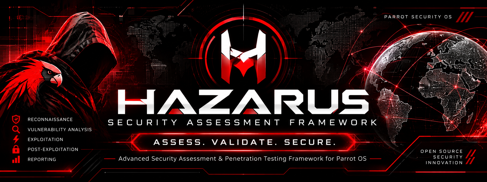
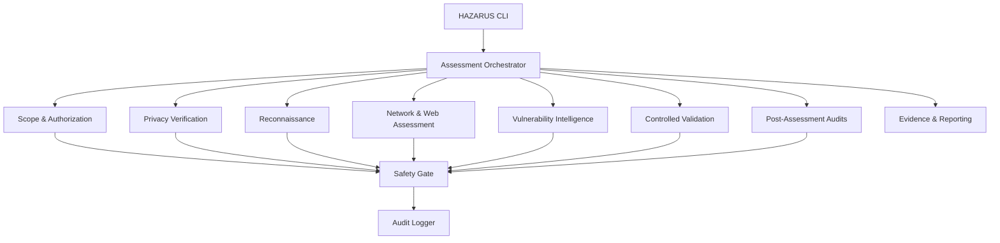

<div align="center">



# HAZARUS

## SECURITY ASSESSMENT FRAMEWORK

### ASSESS. VALIDATE. SECURE.

*Advanced security assessment framework for Parrot Security OS*

[](https://www.python.org/downloads/)
[](https://www.parrotsec.org/)
[](LICENSE)
[](https://www.python.org/downloads/)

</div>

---

## Overview

HAZARUS is a modular, offensive-security oriented assessment framework engineered for Parrot Security OS. It provides reconnaissance, vulnerability assessment, controlled exploitation validation, and post-assessment security auditing capabilities through a unified command-line interface and optional web dashboard.

The framework is designed for authorized security research, penetration testing, and defensive validation. All assessments require explicit target authorization and enforce strict scope boundaries.

## Core Capabilities

### PRIVACY & ANONYMITY
- Anonsurf status integration
- Tor connectivity verification
- DNS leak detection
- IPv6 exposure analysis
- Proxy configuration validation
- Privacy readiness reporting

### RECONNAISSANCE
- DNS enumeration and record analysis
- WHOIS/RDAP queries
- Certificate Transparency log queries
- Subdomain discovery via passive sources
- Passive asset fingerprinting
- Technology identification
- Asset inventory and relationship mapping

### NETWORK ASSESSMENT
- Nmap integration for port and service discovery
- Service version identification
- TLS/SSL configuration analysis
- HTTP security header evaluation
- Web application crawling
- API endpoint discovery

### WEB & API SECURITY
- Nuclei vulnerability scanning
- OWASP ZAP integration
- Nikto web server scanning
- HTTP security header checks
- TLS configuration assessment
- Cookie security analysis
- CORS configuration review
- OpenAPI/Swagger analysis

### VULNERABILITY INTELLIGENCE
- CVE correlation via NVD API
- CVSS score calculation
- Exploit-DB reference research
- GitHub Security Advisories integration
- Vulnerability prioritization
- Service-to-exploit matching

### EXPLOITATION & VALIDATION
- Metasploit Framework RPC integration
- Exploit registry and metadata management
- Target compatibility validation
- Safe proof-of-concept execution
- Isolated laboratory environment execution
- Snapshot-based rollback and cleanup

### POST-ASSESSMENT
- Privilege escalation audits (Linux/Windows)
- Credential exposure detection
- Lateral movement pathway analysis
- Persistence mechanism detection
- Network segmentation assessment
- Synthetic data exfiltration simulation

### CODE ANALYSIS
- Semgrep static analysis integration
- Gitleaks secret detection
- Trivy vulnerability scanning
- Dependency vulnerability analysis
- Secret pattern detection

### REPORTING
- JSON report generation
- Markdown report generation
- HTML report generation
- PDF report generation
- Evidence collection and management
- Executive summary generation

## Architecture



## Assessment Methodology

HAZARUS follows a phased assessment approach:

1. **Privacy Verification** - Anonsurf and Tor connectivity are verified before assessment begins
2. **Scope Validation** - All targets are validated against authorized scope
3. **Reconnaissance** - Passive asset discovery and intelligence gathering
4. **Scanning** - Network and web application vulnerability assessment
5. **Vulnerability Research** - CVE correlation and exploit intelligence
6. **Validation** - Controlled exploitation in isolated lab environments (authorized only)
7. **Post-Assessment** - Security audits for privilege escalation, lateral movement, persistence
8. **Reporting** - Comprehensive evidence-based reports

## Exploitation and Validation Capabilities

HAZARUS provides controlled exploitation capabilities with strict safety controls:

- **Metasploit RPC Integration** - Connect to local msfrpcd for module execution
- **Exploit Registry** - Metadata database for exploit information
- **Target Validation** - Platform, service, and version compatibility checks
- **Lab Environment** - Isolated execution in authorized CIDR ranges
- **Snapshot Management** - Clean snapshot restoration before/after execution
- **Approval Workflow** - Explicit operator approval required for exploitation
- **Audit Logging** - All exploitation operations are logged
- **Automatic Cleanup** - Post-execution cleanup and rollback

## Post-Assessment Security Auditing

Post-assessment modules analyze security posture changes:

- **Privilege Escalation** - SUID/SGID, sudo permissions, Linux capabilities, Windows service permissions
- **Credential Exposure** - SSH keys, password files, cached credentials
- **Lateral Movement** - Network segmentation, trust relationships, AD configuration
- **Persistence** - Systemd services, cron jobs, scheduled tasks, registry autoruns
- **Segmentation** - Network interface analysis, routing tables, firewall rules
- **Exfiltration Simulation** - Synthetic data testing of egress controls

## Installation

### Prerequisites

- Parrot Security OS or Debian-based Linux distribution
- Python 3.11 or higher
- sudo access
- Git

### Quick Install

```bash
# Clone repository
git clone <REPOSITORY_URL>
cd hazarus

# Run installation script
sudo bash install.sh
```

### Manual Install

```bash
# Install Python dependencies
pip install -r requirements.txt

# Install HAZARUS
pip install -e .

# Install external tools (optional but recommended)
sudo apt update
sudo apt install nmap anonsurf nikto
```

### Docker Install

```bash
# Build Docker image
docker build -t hazarus:2.0.0 .

# Run container
docker run -it --net=host hazarus:2.0.0
```

### Verification

```bash
# Display help
hazarus --help

# Initialize configuration
hazarus init
```

## Quick Start

```bash
# Initialize project
hazarus init

# Edit scope configuration
nano config/scope.yaml

# Validate scope
hazarus scope validate

# Check privacy/anonymity
hazarus privacy check

# Perform reconnaissance
hazarus recon example.com

# Run network scan
hazarus scan 192.168.1.0/24

# Run web assessment
hazarus web https://example.com

# Research vulnerabilities
hazarus research --cve-id CVE-2021-44228

# Generate report
hazarus report <assessment-id> --format html

# Start web dashboard
hazarus dashboard
```

## Configuration

### Scope Configuration

Located at `config/scope.yaml`:

```yaml
allowed_targets:
  - "192.168.1.100"
  - "example.com"
allowed_domains:
  - "example.com"
allowed_cidrs:
  - "192.168.1.0/24"
excluded_targets:
  - "192.168.1.1"
allowed_ports:
  - 80
  - 443
  - 22
assessment_window:
  start: "2024-01-01T00:00:00"
  end: "2024-12-31T23:59:59"
intensity: normal
rate_limit: 100
request_limit: 10000
operator_id: "operator@example.com"
client_id: "client-001"
```

### HAZARUS Configuration

Located at `config/hazarus.yaml`:

```yaml
assessment:
  intensity: normal
  privacy_mode: strict
  max_threads: 10
  timeout: 300

logging:
  level: INFO
  file: logs/hazarus.log

privacy:
  require_anonsurf: true
  block_on_dns_leak: true
  block_on_ipv6_exposure: true
```

## Scope and Authorization

HAZARUS enforces strict scope boundaries:

- **Target Allowlist** - Only explicitly authorized targets may be assessed
- **Domain Allowlist** - Domains and subdomains must be in scope
- **CIDR Ranges** - IPv4 and IPv6 ranges are supported
- **Excluded Targets** - Specific assets can be excluded from scope
- **Port Restrictions** - Only authorized ports may be scanned
- **Assessment Windows** - Assessments are restricted to approved time windows
- **Rate Limits** - Request and rate limits prevent unbounded scanning
- **Operator Identification** - All operations are attributed to specific operators

## Anonymity and Privacy Limitations

HAZARUS provides privacy verification but does not guarantee anonymity:

- **Anonsurf** is checked for installation and running status
- **Tor connectivity** is verified through SOCKS proxy checks
- **DNS leaks** are detected and reported
- **IPv6 exposure** is analyzed and flagged
- **Proxy configuration** is validated
- **Tool Compatibility** - Some tools may bypass proxy settings

**Important:** Tor routing does not guarantee complete anonymity. DNS leaks, IPv6 traffic, application-level leaks, and browser fingerprinting can all compromise anonymity. The privacy gate identifies these issues but does not prevent all risks.

## Reports and Evidence

HAZARUS generates comprehensive assessment reports:

- **JSON** - Machine-readable format for integration
- **Markdown** - Plain text documentation
- **HTML** - Styled web report with severity color-coding
- **PDF** - Professional formatted report

Evidence is collected in `~/.hazarus/evidence/` and includes:
- Screenshots and output captures
- Configuration files
- Scan results
- Audit logs

## Technology Stack

- **Language:** Python 3.11+
- **CLI Framework:** Typer
- **Validation:** Pydantic
- **Terminal UI:** Rich
- **Database:** SQLAlchemy (SQLite)
- **Web Framework:** FastAPI
- **Async Runtime:** asyncio
- **HTTP Client:** httpx, aiohttp
- **DNS:** dnspython
- **HTML Parsing:** BeautifulSoup4
- **Cryptography:** Python cryptography
- **External Tools:** Nmap, Anonsurf, Nikto, Nuclei, Semgrep, Gitleaks, Trivy

## Project Structure

```
hazarus/
├── assets/                          # Project assets
│   └── hazarus-banner.png
├── core/                            # Core engine and orchestration
│   ├── engine.py
│   ├── orchestrator.py
│   ├── scheduler.py
│   ├── event_bus.py
│   ├── task_manager.py
│   └── state_manager.py
├── security/                        # Scope, authorization, safety
│   ├── scope.py
│   ├── authorization.py
│   ├── safety_gate.py
│   ├── audit_logger.py
│   └── policy_engine.py
├── anonymity/                       # Anonymity verification
│   ├── anonsurf.py
│   ├── tor_check.py
│   ├── dns_leak.py
│   ├── ipv6_check.py
│   ├── proxy_validation.py
│   └── privacy_report.py
├── reconnaissance/                  # Asset discovery
│   ├── dns.py
│   ├── whois.py
│   ├── subdomains.py
│   ├── crtsh.py
│   ├── passive_recon.py
│   └── asset_inventory.py
├── scanning/                         # Network and service scanning
│   ├── nmap.py
│   ├── service_detection.py
│   ├── tls_analysis.py
│   ├── http_scanner.py
│   ├── web_crawler.py
│   └── api_discovery.py
├── vulnerability/                    # Vulnerability assessment
│   ├── nuclei.py
│   ├── owasp_zap.py
│   ├── nikto.py
│   ├── cvss.py
│   ├── cve_matcher.py
│   ├── exploitdb.py
│   └── github_advisories.py
├── exploitation/                     # Exploitation subsystem
│   ├── exploit_engine.py
│   ├── exploit_registry.py
│   ├── exploit_matcher.py
│   ├── metasploit_rpc.py
│   ├── validation.py
│   ├── lab_executor.py
│   └── cleanup_manager.py
├── post_assessment/                 # Post-exploitation audits
│   ├── privilege_audit.py
│   ├── credential_exposure.py
│   ├── lateral_movement_audit.py
│   ├── persistence_audit.py
│   ├── exfiltration_simulation.py
│   └── segmentation_audit.py
├── code_analysis/                    # Source code analysis
│   ├── semgrep.py
│   ├── gitleaks.py
│   ├── trivy.py
│   ├── dependency_audit.py
│   └── secret_analysis.py
├── reporting/                        # Report generation
│   ├── report_engine.py
│   ├── executive_summary.py
│   ├── evidence_manager.py
│   ├── html_report.py
│   ├── pdf_report.py
│   └── json_report.py
├── dashboard/                       # Web dashboard
│   ├── backend/
│   │   └── main.py
│   └── frontend/
│       ├── package.json
│       ├── vite.config.ts
│       ├── tailwind.config.js
│       ├── tsconfig.json
│       └── src/
├── integrations/                     # External tool integrations
│   ├── metasploit/
│   ├── zap/
│   ├── nuclei/
│   ├── nmap/
│   └── external_apis/
├── config/                          # Configuration files
├── scripts/                         # Utility scripts
│   ├── update.sh
│   └── __init__.py
├── tests/                           # Test suite
│   ├── test_core.py
│   ├── test_integration.py
│   └── test_units.py
├── docs/                            # Documentation
│   ├── USER_GUIDE.md
│   ├── EXPLOITATION.md
│   └── METASPLOIT_INTEGRATION.md
├── hazarus/                         # CLI entry point
│   ├── __init__.py
│   └── cli.py
├── Dockerfile
├── install.sh
├── uninstall.sh
├── pyproject.toml
├── requirements.txt
├── AGENTS.md
└── README.md
```

## Security Considerations

### Scope Enforcement

- All targets must be explicitly authorized in scope configuration
- Scope is validated before every active operation
- Assessment windows restrict execution to approved time periods
- Rate and request limits prevent unbounded scanning
- Emergency stop capability terminates all operations immediately

### Privacy Controls

- Privacy verification is mandatory before assessments
- DNS leaks, IPv6 exposure, and proxy bypass are detected
- Tor connectivity is verified but not guaranteed
- Some tools may bypass configured proxy settings
- Privacy gate can block assessments if policies fail

### Exploitation Safety

- Exploitation requires lab environment verification
- All lab targets must be in authorized CIDR ranges
- Explicit operator approval is required for exploit execution
- Exploits execute with hard timeouts
- Snapshots are restored before and after execution
- All exploitation is logged for audit trails

### Audit Logging

- All operations are logged with timestamps
- Operator identification is required
- Scope changes are logged
- Exploitation attempts are logged with full details
- Logs are stored in `~/.hazarus/audit_logs/`

## Roadmap

### Implemented Features

- [x] Core engine and orchestration
- [x] Scope management and authorization
- [x] Privacy verification (Anonsurf, Tor, DNS, IPv6)
- [x] Reconnaissance (DNS, WHOIS, subdomains, CT logs)
- [x] Network scanning (Nmap, service detection, TLS)
- [x] Web assessment (HTTP headers, crawling, API discovery)
- [x] Vulnerability scanning (Nuclei, ZAP, Nikto)
- [x] CVE research and correlation
- [x] Exploitation subsystem with Metasploit RPC
- [x] Lab execution with snapshot management
- [x] Post-assessment audits
- [x] Code analysis (Semgrep, Gitleaks, Trivy)
- [x] Reporting (JSON, Markdown, HTML, PDF)
- [x] Web dashboard (FastAPI + React)
- [x] Installation scripts and Docker support

### In-Progress Features

- [ ] External tool installation automation
- [ ] Additional exploit database integrations
- [ ] Enhanced Metasploit module templates
- [ ] Advanced reporting templates

### Planned Features

- [ ] CI/CD pipeline integration
- [ ] Additional dashboard visualizations
- [ ] Collaboration features for team assessments
- [ ] Automated scheduling
- [ ] API key management
- [ ] Cloud platform integrations

### Research Objectives

- [ ] Enhanced TLS fingerprinting
- [ ] Advanced lateral movement detection
- [ ] Machine learning-based anomaly detection
- [ ] Custom exploit framework development

## Contributing

### Contribution Guidelines

Contributions are welcome from security researchers and developers. All contributions must:

1. Follow the existing code style and architecture
2. Include tests for new functionality
3. Update documentation for new features
4. Pass all existing tests
5. Not introduce new security vulnerabilities

### Code Quality Requirements

- Type hints are required for all new code
- Functions must include docstrings
- Async functions must use proper error handling
- No shell=True in subprocess calls
- Validate all user inputs
- Follow existing import patterns

### Testing Requirements

- Unit tests for individual modules
- Integration tests for component interaction
- Tests must not require external infrastructure
- Coverage should be maintained above 80%

### Issue Reporting

Report bugs and security issues via GitHub Issues. Include:

- HAZARUS version
- Python version
- Operating system
- Steps to reproduce
- Expected vs actual behavior
- Logs and error messages

### Pull Request Workflow

1. Fork the repository
2. Create a feature branch
3. Make your changes
4. Run tests: `pytest`
5. Update documentation
6. Submit pull request with clear description

### Security-Sensitive Contributions

Exploitation modules, safety controls, and scope enforcement require additional review. Security-sensitive changes will be reviewed by maintainers before merge.

## Responsible Disclosure

HAZARUS is designed for authorized security testing only. Users must:

- Obtain explicit written authorization before testing
- Comply with all applicable laws and regulations
- Use only within defined scope boundaries
- Report findings responsibly to affected parties
- Never use the framework for unauthorized access
- Never target third-party systems without authorization

## Disclaimer

HAZARUS is provided for authorized security research, penetration testing, and defensive validation only. The authors are not responsible for misuse of this software. Users are solely responsible for ensuring their use complies with all applicable laws and regulations.

Exploitation capabilities are provided for validation in authorized lab environments only. Production exploitation without explicit authorization is prohibited.

Tor and Anonsurf provide routing but do not guarantee complete anonymity. DNS leaks, IPv6 traffic, application-level leaks, and browser fingerprinting can all compromise anonymity. Users must understand these limitations.

## License

MIT License - See [LICENSE](LICENSE) file for details.

## Credits

Developed by the HAZARUS Security Team

Built with:
- Python 3.11+
- Typer (CLI)
- Pydantic (Validation)
- Rich (Terminal UI)
- FastAPI (Web API)
- Nmap, OWASP ZAP, Nuclei, Nikto
- Semgrep, Gitleaks, Trivy
- Parrot Security OS community

---

<div align="center">

# HAZARUS SECURITY ASSESSMENT FRAMEWORK

### ASSESS. VALIDATE. SECURE.

*Built for authorized security research, penetration testing, and defensive validation.*

</div>
